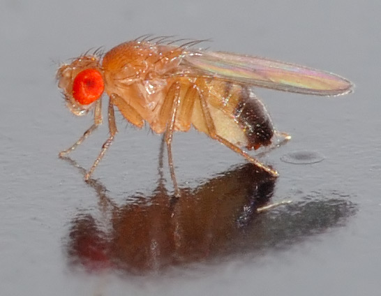

# famous-people

Homemade Cursor skill. Fully understand a researcher from public sources, with every line cited, to help choose an advisor or a collaborator. It can also write one biologist’s scientific life as a Chinese WeChat longread.

自制 Cursor 技能。从公开来源全面了解一位研究者，逐条标出处，帮助选导师、找合作者；也可以把一位生物学家的科学人生写成中文公众号长文。

## What it does / 它做什么

Give it a researcher name. It collects and organizes what is public about that person, so that you can choose an advisor or a collaborator, or simply get to know them. Every line cites a page, record or paper that was actually opened; what could not be found is marked unknown.

给一位研究者的姓名，它从公开来源收集并整理关于这个人的信息，帮你选导师、选合作者，或者了解这个人。每一条都带一个真正打开过的页面、记录或论文；找不到的写未知。

| Part of the profile | What goes in |
|---|---|
| Identity | ORCID, OpenAlex id, Google Scholar, lab page, and why they are one person |
| Career and lineage | Positions, degrees, advisors and host labs |
| Research over time | Directions by period, key papers with DOIs checked on Crossref |
| Output and metrics | Counts with their caveats |
| Grants | Public funder records |
| Lab | Current size, join announcements, where former members went (counts) |
| Collaborators | Frequent co-authors and a small network |
| Mentoring signals | Dated things the person said or the lab published, labelled as signals |
| Public personal background | Only what the person or a named outlet made public, labelled Self-stated or Reported by |
| Social media and public presence | Accounts tied to the person by an official page, and what is public |
| Community reactions | Formal, press and community reactions, with who said it and when |
| Recent activity, openings, contact | Latest work, admissions text, the contact route the lab asks for |
| Records to check | Retraction, correction and concern notices, stated neutrally |
| Fit checklist and questions | What to tick, what to ask in a first email or interview |

A person with little public information gets a short profile that says so. Nothing is padded.

公开信息很少的人，得到的是一份写明“很少”的短档案，不会凑数。

## Quick start / 快速开始

```text
python3 profile/scripts/openalex_author.py search --name "Given Family"
python3 profile/scripts/openalex_author.py fetch --id A1234567890 --out work/<slug>/openalex
python3 profile/scripts/openalex_author.py summary --dir work/<slug>/openalex --out work/<slug>/openalex/summary.md
python3 profile/scripts/coauthors.py --dir work/<slug>/openalex --out-dir work/<slug>/network
python3 profile/scripts/check_dois.py --works work/<slug>/openalex/works.jsonl --out work/<slug>/doi_check.tsv
python3 profile/scripts/check_profile.py work/<slug>/PROFILE.md
```

Read `profile/PRIVACY.md` and `profile/WORKFLOW.md` first. Copy `profile/templates/profile.en.md` or `profile.zh.md` to `work/<slug>/PROFILE.md` and fill it in. Other helpers: `orcid_record.py`, `nih_reporter.py`, `lab_page.py`, `social_links.py`. The source list is `profile/SOURCES.md`; the first email and interview questions are in `profile/templates/outreach.en.md` and `outreach.zh.md`. The scripts use only the Python standard library and public sources, and never overwrite a file. Offline tests: `python3 -B profile/scripts/test_profile_scripts.py`.

先读 `profile/PRIVACY.md` 和 `profile/WORKFLOW.md`，再把 `profile/templates/` 里的模板复制到 `work/<slug>/PROFILE.md` 填写。脚本只用 Python 标准库和公开来源，不覆盖已有文件。

## Worked example / 案例

[`examples/doudna/`](examples/doudna/README.md) is a full profile of a well-known public scientist, in English and Chinese, with the data files behind it. Every fact carries a source that was opened on the day. It shows the method and its limits; it is not an assessment of the person.

[`examples/doudna/`](examples/doudna/README.md) 是一位知名公开科学家的完整档案，中英文各一份，附带背后的数据文件。每个事实都带当天打开过的来源。它演示方法和局限，不是对这个人的评价。

## Privacy and neutrality / 隐私和中立

Public information only: the professional record, personal background that the person or a named outlet made public, public accounts that an official page ties to the person, and public reactions. No home address, no non-public data, no locked accounts, no sign-ins, no scraping, no background checks, no doxxing. Reactions are recorded as reactions, never as findings, and unverified allegations are not repeated. Details in [`profile/PRIVACY.md`](profile/PRIVACY.md). Profiles of real people are written under `work/`, which git ignores.

只用公开信息：职业记录、本人或署名媒体公开的个人背景、官方页面能对应到本人的公开账号、公开的反应。不查家庭住址，不碰非公开数据，不看加锁账号，不登录，不抓取，不做背景调查，不做人肉搜索。反应只记为反应，不当结论，未经核实的指控不转述。细则见 [`profile/PRIVACY.md`](profile/PRIVACY.md)。真人的档案写在 `work/` 下，git 会忽略它。

## Optional output: WeChat longread / 可选输出：公众号长文

It checks the sources, finds existing figures, and writes the way a scientist writes for a magazine. It does not post unless you say so.

查证、找现成的图，按科学家给杂志写人物的方式成文。未明确要求时不发布。

## Example / 案例

<p align="center">
  <a href="examples/morgan/article.md">
    
  </a>
</p>

**Morgan** — [full article](examples/morgan/README.md)

托马斯·亨特·摩尔根：果蝇的白眼改变了他对遗传学的看法。九张现成的图，后续写到 2024 年的果蝇全脑。



*安德烈·卡瓦特摄，Wikimedia Commons，CC BY-SA 2.5。*

## Install / 安装

```bash
git clone https://github.com/Xuzhen-Li/famous-people.git
mkdir -p ~/.cursor/skills
ln -sfn "$(pwd)/famous-people" ~/.cursor/skills/famous-bio
```

Needs Python 3.10+. The slash command is `/famous-bio`. This skill is not auto-attached: read `SKILL.md` first, and do not load other skills.

需要 Python 3.10+。命令是 `/famous-bio`。本技能不会自动挂上：先读 `SKILL.md`，不加载其他 skill。

## Use / 用法

This section is for the longread mode. For researcher profiles see Quick start above.

本节是长文模式；研究者档案见上面的快速开始。

In the workspace where you want `work/<slug>/`:

在要写出 `work/<slug>/` 的工作区里：

```text
/famous-bio 写下一篇：托马斯·亨特·摩尔根
```

Four steps / 四步：

1. Research → `work/<slug>/facts.md`（`templates/facts.md`，`references/research.md`）.
2. Draft and figures → `work/<slug>/draft.md`，图放 `work/<slug>/figures/`，登记 `figures.md`（`references/style.md`，`references/figures.md`）.
3. Read aloud, write `revise.md` against the questions at the end of `references/style.md`, then `article.md`.
4. Check: `python3 scripts/check_article.py work/<slug>/article.md`. Fix every ERROR. Read each WARN and decide.

查证、写和配图、按改稿问题自改、跑检查。有 ERROR 就改；WARN 读一下再判断。

Famous lives usually land at 6000–9000 Chinese characters, others at 4000–6000. That length is what you get after the seven parts are actually told: the era, the person, one or two core pieces of work, the lab, how the work was received, what later research did with it up to the present decade, and the late life. It is not a target to pad or to cut toward.

著名人物一般 6000–9000 字，一般人物 4000–6000 字。字数是七样都讲开以后的结果：时代、本人、一两件核心工作、实验室、当时怎样被接受、后人做到今天的进展、晚年。不是凑字或砍字的目标。

Use existing plates and photographs. Do not draw diagrams for the article.

用现成的图版和照片。不为文章自己画图。

## File map / 文件

| Path | Role |
|------|------|
| `SKILL.md` | Agent entry: what the piece is, and the four steps |
| `references/style.md` | How the prose should read, and the revision questions |
| `references/research.md` | Where to look, and how deep |
| `references/figures.md` | Where to find figures, licenses, captions |
| `templates/facts.md` | Fact sheet |
| `scripts/check_article.py` | Mechanical check |
| `scripts/test_check_article.py` | Tests for the checker |
| `examples/morgan/` | One finished article and its figures |
| `profile/WORKFLOW.md` | The researcher profile workflow, step by step, English and Chinese |
| `profile/PRIVACY.md` | What is collected, what never is, how to word reactions |
| `profile/SOURCES.md` | Source checklist with addresses and cautions |
| `profile/templates/` | Profile templates (English, Chinese), first email and interview questions |
| `profile/scripts/` | OpenAlex, ORCID, Crossref, NIH, lab page, social links, co-author network, the profile check, and offline tests |
| `examples/doudna/` | One finished profile, English and Chinese, with its data files and source log |

`work/` holds one article's notes and draft. It is gitignored and is not part of this package. So are private exemplars and the previous rebuild notes.

`work/` 是一篇的笔记和成稿，已忽略，不属于本包。私有范文和上一轮重建笔记同样不发布。

## Checker / 检查

From this directory / 在本目录：

```bash
python3 scripts/check_article.py work/<slug>/article.md
python3 scripts/check_article.py work/<slug>/article.md --json
python3 scripts/test_check_article.py
```

Exit 0 means no ERROR. WARN is a reading prompt, not a failure. The checker does not decide whether a fact is true.

退出码 0 表示没有 ERROR。WARN 是给写手看的提示，不是失败。检查器不判断事实对不对。

## License / 许可

MIT for this skill's text and code, including the example article. The example images keep the licenses in `examples/morgan/figures/SOURCES.md`.

本技能的文字和代码为 MIT，案例正文也一样。案例图片的许可写在 `examples/morgan/figures/SOURCES.md`。
